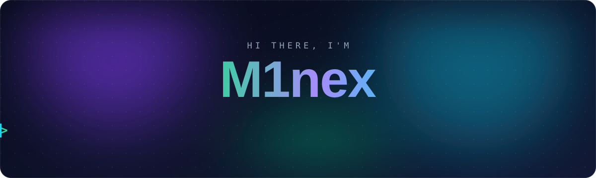
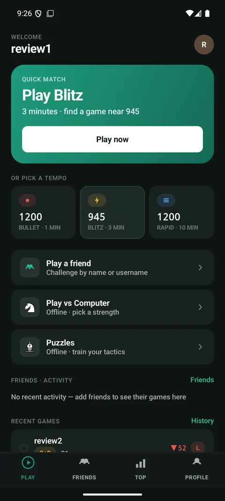
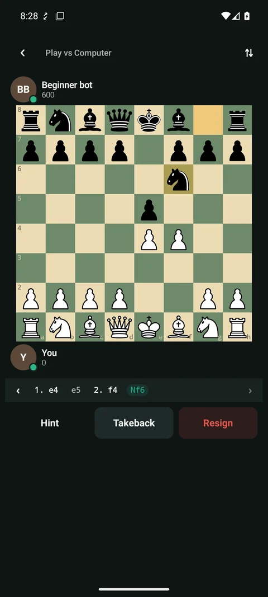
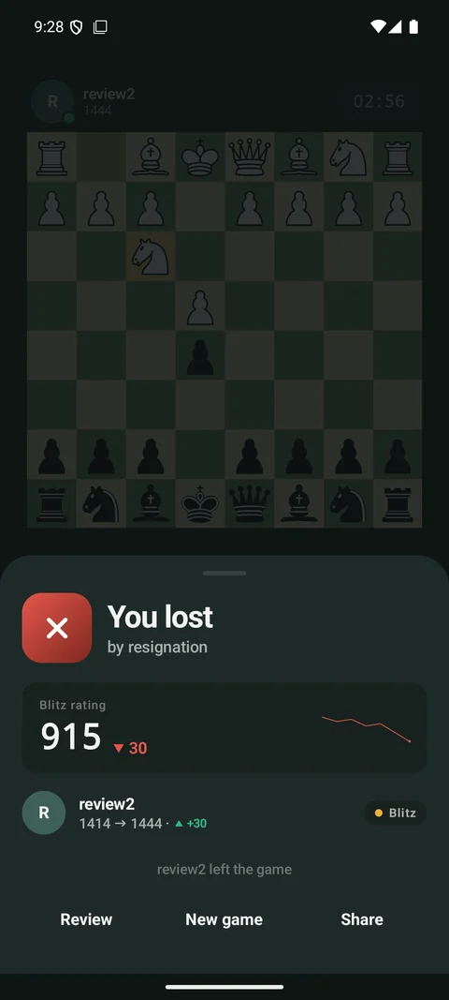
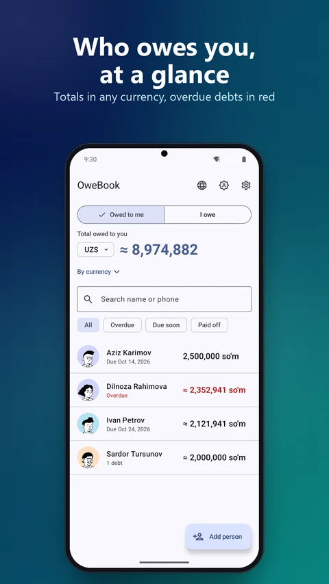
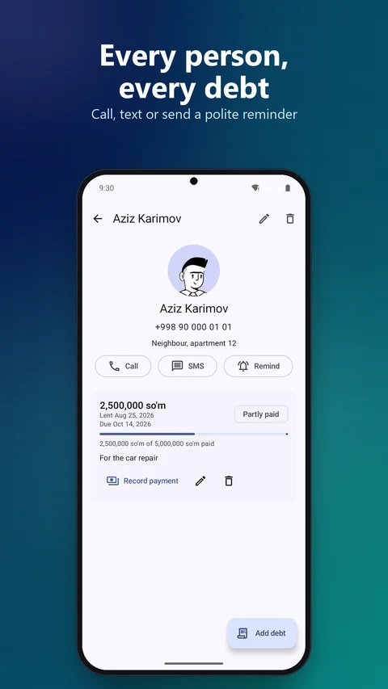

  

  
  

<picture>
  <source media="(prefers-color-scheme: dark)" srcset="assets/svg/title-featured-dark.svg" />
  
</picture>

### ♟️ Brilliant Chess

Real-time rated chess, offline bots and puzzles, one Kotlin Multiplatform codebase.

- Live Bullet, Blitz and Rapid games over WebSocket; the server validates moves and runs the clocks
- ELO rating, rating-based matchmaking and direct challenges
- Offline play vs. the computer and offline puzzles, guest mode included
- Friends, online status, in-game chat, leaderboards and game history with PGN export

**Stack:** Kotlin · Compose Multiplatform · Ktor · Koin · Decompose · Firebase &nbsp;|&nbsp; Spring Boot · PostgreSQL · JWT

  
  
  

### 📒 OweBook

Offline-first debt ledger: who owes you and whom you owe, in four currencies.

- Two ledgers, *Owed to me* and *I owe*, with Overdue / Due soon / Paid off filters
- So'm, USD, RUB and EUR, with totals converted at current rates
- Partial repayments; the balance is always derived from payments, never typed in
- Due-date notifications and one-tap call, SMS or a polite reminder via any messenger
- Works fully offline and syncs in the background; English, Russian and Uzbek

**Stack:** Kotlin · Jetpack Compose · Hilt · Room · WorkManager · Supabase (Postgres + RLS)

  
  

### 🌗 [theme-transitions](https://github.com/M1nexoff/theme-transitions) &nbsp;·&nbsp; open source

Theme switch animations for Compose Multiplatform: circle, flood, wipe, fade, dissolve and a rift that tears the screen open, with rings, sparks and lightning.

  
  
  

### 🚀 [NoLag Launcher](https://github.com/M1nexoff/NoLagLauncher) &nbsp;·&nbsp; open source

A highly optimized, minimalistic Android home launcher.

<picture>
  <source media="(prefers-color-scheme: dark)" srcset="assets/svg/title-now-dark.svg" />
  
</picture>

### 📺 Smartcast: digital-signage platform

- **Smartcast TV**: the Android TV player running on the screens. It handles Media3/ExoPlayer playback, offline content, remote control over MQTT and FCM, a kiosk launcher, and a computer-vision edition with on-device camera.
- **Smartcast Dashboard**: the admin app (Compose Multiplatform, Android + iOS, phones and tablets) for managing screens, groups and content from your phone.

<picture>
  <source media="(prefers-color-scheme: dark)" srcset="assets/svg/title-stack-dark.svg" />
  
</picture>

  
  
  
  
  
  
  
  
  
  

  <picture>
    <source media="(prefers-color-scheme: dark)" srcset="https://raw.githubusercontent.com/M1nexoff/M1nexoff/output/github-snake-dark.svg" />
    
  </picture>

